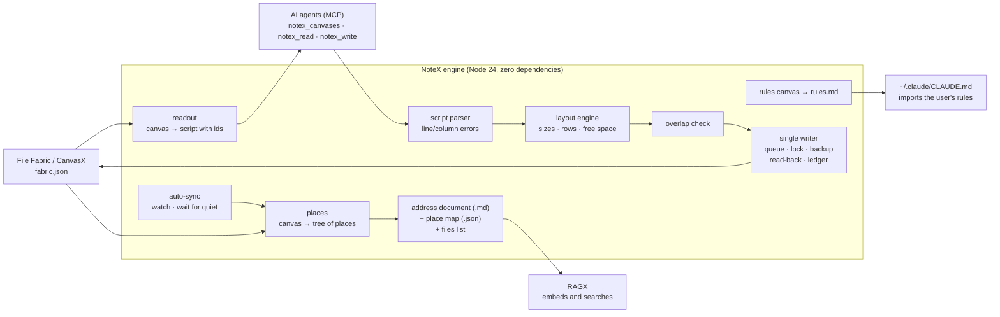

# NoteX

**The bridge between a spatial canvas and AI: it turns File Fabric / CanvasX canvases into documents AI can search, and lets AI agents write on those canvases safely.**


People plan on infinite canvases: boxes inside boxes, notes with checklists, files dropped next to the idea they belong to, and lines linking related things. That layout *is* information: what sits inside what, what is next to what, what is linked. A plain text export throws it away.

NoteX keeps it, in both directions:

1. **Canvas → AI.** NoteX reads a canvas and writes it out as a tree of **places**. Every place has an address such as `Thesis (totem) > Reading plan > Collect`, which travels with everything inside it. RAGX embeds those documents, so an AI answer can say *where* on the canvas something is.
2. **AI → canvas.** Agents write on a canvas in a small **tag-based script language**. They describe only *what goes inside what*. NoteX works out every size and position, checks for overlaps, and writes the canvas without ever touching the user's own items.

It runs as a page inside ter-manager (a desktop app that hosts plugins), as a command-line tool, and as an **MCP server** for AI coding agents.

---

## Why this was hard

| Problem | What NoteX does |
|---|---|
| **The canvas file is the app's internal state**, not a document format. Nesting, pages and grouping depend on rules inside the app's 11,000-line `script.js`. | File Fabric's geometry and placement rules were **ported line by line**, odd corners included, with the original line number beside each function. NoteX trusts what the app saved and uses the ported rules only where a value is missing. |
| **Two writers, one file.** File Fabric keeps an open canvas in memory and overwrites `fabric.json` on every save. | NoteX is the **only** writer for agents. Scripts wait in a persisted queue until the canvas's `.fabric_lock` is stale (30 s, the same rule File Fabric uses). Each write re-reads the file, checks that neither the file nor the lock changed, keeps a backup (last 20 per canvas), writes a temp file and renames it into place, **reads it back**, and restores the backup if anything promised is missing. |
| **Agents can't lay things out.** An LLM guessing pixel coordinates produces overlapping boxes. | A **layout engine** sizes everything from the inside out: text by wrapped lines at its font size, notes by File Fabric's own font and padding, images by the real size in the file header. It places boxes with `<Row>`/`<Column>`, finds free space so a new group can't be absorbed into a neighbouring one, grows parent boxes when content is added, and runs an **overlap check** before writing. |
| **No browser to measure text in** | Text sizes are estimated slightly large from File Fabric's own fonts and line heights. Once the app has drawn a text and saved its real height, the real height wins and boxes grow to fit. |
| **Agents must never damage the user's work** | Every item an agent writes is marked as the agent's, and a ledger fingerprints it. If the user later edits it, it becomes the user's: NoteX refuses to change, move or remove it. The user's own items are never moved; layout problems are reported, not "fixed". |
| **Clear errors for agents** | A hand-written parser with size and depth limits. Every refusal names its **line and column**, and a script is applied completely or not at all. |
| **Keeping the AI's copy current without hammering the machine** | Auto-sync checks watched canvases every 5 s, waits for 15 s of quiet after a save, syncs at most once a minute, and RAGX re-embeds only the places that changed. |
| **Images on a canvas** | Each image is read once by Claude Haiku (through RAGX), cached by its SHA-256, and its reading is written under the place where the image sits. |

---

## Architecture



---

## The totem script

This is how an agent writes on a canvas. The script says only what is inside what. Not one coordinate.

```xml
<Canvas name="Thesis">
  <Totem name="Reading plan">
    <Row>
      <Area name="Collect"><Note name="Todo">- [ ] find papers</Note></Area>
      <Area name="Read"><Text>Survey first.</Text></Area>
    </Row>
    <Link from="Collect" to="Read"/>
  </Totem>
</Canvas>
```

Later scripts can change the agent's own work:

```xml
<Add canvas="Thesis" at="Reading plan (totem) > Collect"> ... </Add>
<Canvas name="Thesis"><Edit id="1793...">new words</Edit></Canvas>
<Canvas name="Thesis"><Remove id="1794..."/></Canvas>
```

| Tag | Meaning |
|---|---|
| `<Canvas>` | the canvas to write on; created if it doesn't exist |
| `<Totem>` | a named group, the agent's own; one per script |
| `<SubTotem>` | a named group inside a totem, one level only (a book's chapter, a game's car); laid out side by side under the totem's own content, its places read `Book (totem) > Chapter 1 (sub-totem) > ...` |
| `<Area>` | a box that holds other items |
| `<Note>` | a note card, with `- [ ]` checklists; `drop="d-..."` takes its words from the Inbox |
| `<Text>` | free text |
| `<File>` | a file or image, copied into the canvas; `drop="d-..."` places a PDF, Word file or image from the Inbox |
| `<Image>` | a picture the agent draws: one SVG inside `<![CDATA[ ... ]]>` (at most 60 KB, no scripts, handlers or outside links), saved as `<name>.svg` on the canvas and shown as an image. Ask the agent in the chat for a diagram or chart and it draws one |
| `<Row>` / `<Column>` | side by side / stacked inside a row |
| `<Link>` | joins two boxes corner to corner, as the app's own links do |
| `<Line>` | draws a line only |
| `<Add>` / `<Edit>` / `<Remove>` | grow, reword or delete the agent's own items |

`notex_read` returns a canvas as the same script, with every item's id and every totem's owner. An agent reads it first, then writes.

---

## Features

**Canvas → documents**
- Every canvas becomes an **address document** (Markdown, one section per place, its heading the place's full address) and a **place map** (JSON) for moving between places.
- Each place lists what it contains, its three nearest neighbours and which direction they lie in, its links, and checklist progress. Progress is read from the notes themselves, the same way File Fabric's progress bars count it.
- Files on a canvas are listed with their places, so RAGX can index a PDF *and* know which box it sits in.

**Keep in RAGX**
- Switch a canvas on and it follows File Fabric's saves into RAGX automatically.

**Inbox** (the first layer of the data pipeline, in progress)
- The Inbox sends like a chat prompt. Attach files (text, Markdown, PDF, Word, images), say **what it is** below them, and optionally write **to the agent** where it goes and what to call it, then press **Send**. With no file, what you write is itself kept as text. `npm run notex -- drop` works from the command line.
- Each file is its own drop, carrying your description and your message. Each is checked to be what its name says and kept exactly as it arrived, stored once by its SHA-256. A send lands whole or not at all.
- A drop waits until you pick a canvas assigned to the agent, or pick **As my message says**: the agent then puts it on the agent canvas your message names, or on a new canvas it asks for ("make a new canvas Bills, with this in a totem March"), which NoteX creates already assigned to the agent. It never writes on your own canvases.
- **Forget** removes a drop for good: from its totem scripts (and any link to its note), from the canvas, from its copy in `sources/`, from the backups that held it, from bronze and from RAGX. The erasure log keeps no content. Earlier script versions keep only its id.

**Agent canvases** (assigned to the agent in CanvasX, or from NoteX's Agent canvases view)
- **The Agent canvases view** in ter-manager lists every canvas with whose it is and whether CanvasX has it open. From there you can assign an empty, closed canvas to the agent or take one back. For each agent canvas it shows the totem scripts (owner, earlier versions, drops, what the last render drew each from, errors, and the script itself), its activity, and a Draw again button.
- The canvas is drawn from one totem script per totem. An agent changes a totem by sending its whole script again, and the new version is kept only if the canvas still draws with it. Every earlier version is kept, along with the last one that drew.
- Totems stay where they were first placed; one that grows wider pushes the totems after it. Every render keeps totems at least 1,600 apart, past CanvasX's grouping reach (750 round a totem's marker, 450 between items), and then groups the canvas the way CanvasX does: a totem that would take another's boxes is moved right until each holds only its own. An empty totem counts by its marker. Each move is in the canvas's activity. A script that stops drawing is drawn from its last good version, so one broken totem never takes the others with it.
- Scripts name Inbox drops by id, so the content stays in one place. A drop placed this way is marked placed.
- **The agent places drops by itself.** Once you pick a drop's canvas, NoteX shows Claude Code (headless, with no tools) the canvas's scripts, the drops, your description and your message, and takes back one totem script. Images are shown as the images themselves, so the agent looks at them; PDFs and Word files go by name and description. Files sent together are placed together, in that one script. The script must place every drop and keep everything its totem already held, word for word, or Claude is asked once more with the reason. A switch on the Inbox turns placing off, and a picker beside it chooses the model: Sonnet, Opus or Haiku.
- **Chat with the agent** about an agent canvas: beside the canvas in CanvasX, or in the Agent canvases view. Ask about it ("how many bugs are here?") or tell it how to arrange it ("arrange it by topic, with bugs and ideas apart"), and pick Sonnet, Opus or Haiku. Claude Code, headless, sees the canvas's scripts, what every drop on it is (name, your description, a text's words), the images themselves, the last 10 turns and your message. It answers in a few sentences and, only when you ask for a change, sends whole scripts for the totems it changes. NoteX takes them only if everything the canvas held (every drop, note, text and file) is still on it somewhere, and draws them all at once, so they land together or not at all. Boxes and names may change; wires to a note that moved may be dropped. A totem cannot be deleted or renamed this way. NoteX keeps the whole conversation per canvas (`chat.jsonl`), and both places show it. In CanvasX's chat you can also attach, drop or paste files and images with the message ("make a sub-totem Nissan GTR with the photo and the setup notes side by side"): NoteX keeps each as a drop of that canvas and the agent places them as you say, in the same answer.
- **How CanvasX reaches NoteX**: at each start NoteX writes `.notex/link.json` into the workspace, with its address and a link token that opens only an agent canvas's chat, and removes it when it stops. CanvasX reads it through the workspace folder it already has open; its page (port 9075) is let through for those routes only.
- Your description stays in the Inbox; RAGX gets the files, not the description, for now.
- **On to RAGX**: after every render NoteX lists the drops on the canvas, each with its place and drop time, and RAGX takes each as a document of its own, searchable by when it was dropped. The list waits while RAGX is stopped. The agent canvas itself is always kept in RAGX too, as a canvas document synced 15 s after each change, with no switch to forget, so its totems, boxes and the agent's own notes are searchable. Take the canvas back from the agent to stop that. A text drop placed as a note is therefore found twice, as part of the canvas and as its own document; a dropped file is not (RAGX gives the document it has another place). In RAGX's search range these canvases are listed under **Notes assigned to agent**, each with its drops beneath it.

**Phone sync over USB** (with CanvasXP, CanvasX's edition for phones)
- **Set up once, on both sides.** On the phone, open CanvasXP, open its target folder and press **Set up USB sync**. Plug the phone in, pick **File transfer** on the phone, and in NoteX's **Phone** view pick the phone and open that same folder. NoteX knows it by the `_canvasxp/device.json` CanvasXP wrote there.
- **Phone attached - sync** brings the two up to date, canvas by canvas. What changed on one side goes to the other. If both changed, the PC keeps its version and the phone's comes in beside it as "Name (phone)", on both sides, so nothing is lost. A canvas deleted on one side and unchanged on the other is deleted on both, with the PC's copy backed up first. Agent canvases go only from the PC to the phone. A canvas open in CanvasX on the PC waits for the next sync.
- **What changed is decided by SHA-256 hashes**, never dates, so the phone's and PC's clocks don't matter. CanvasXP lists every file with its hash in `_canvasxp/manifest.json`; NoteX compares that, the PC's files, and the hashes both sides had at the last sync.
- **Nothing on the phone is replaced or deleted by NoteX.** Over File transfer, Windows asks before doing either, so NoteX copies a new batch folder into `_canvasxp/incoming/` (its files first, then `changes.json`). CanvasXP takes it in the next time it shows its home screen, and only once every file's hash checks, so pulling the cable mid-copy changes nothing.
- **Canvases that come from the phone are kept in RAGX**, so what you write on the phone becomes searchable on the PC.
- Works with Android phones in File transfer mode, with no developer options needed. NoteX copies through Windows' own shell (`mtp.ps1`), so it needs Windows.

**Rules canvas**
- Mark one canvas as your rules. NoteX writes your own typed words from it to `rules.md`, and one import line in `~/.claude/CLAUDE.md` gives every Claude Code session those rules. Only the user's words go in; agents are refused on this canvas.

**Agents write canvases (MCP)**

| Tool | Purpose |
|---|---|
| `notex_canvases` | list canvases, with scripts waiting or done |
| `notex_read` | a canvas, or one place on it, as a totem script with ids and owners |
| `notex_write` | send a totem script; it is written now, or queued while the canvas is open |

---

## Tech stack

- **Node.js 24**, ES modules, **zero npm dependencies**
- Hand-written parser, layout engine, overlap checker, PNG/JPEG/GIF/WebP/BMP header readers
- **MCP** server written by hand: JSON-RPC 2.0 over stdio
- Loopback HTTP server with token, origin and host checks
- Plugin page in vanilla HTML/CSS/JS

## By the numbers

| | |
|---|---|
| Engine and page source | ~4,900 lines |
| Tests | 150, all passing, in ~3,250 lines |
| Runtime dependencies | 0 |
| Commits | 22, each explaining *why* |

---

## Getting started

### Requirements
- Node.js **24 or newer**
- A File Fabric / CanvasX workspace folder
- **RAGX** running beside it, for search and image reading (optional for building documents)

### Install and test
```bash
npm test
```

### Command line
```bash
npm run notex -- fabrics "<workspace folder>"              # canvases, newest first
npm run notex -- build "<workspace>/<canvas>"              # print one canvas's document
npm run notex -- build "<workspace>" --out ./docs          # a whole workspace
npm run notex -- serve --data-dir ./data                   # the page's engine on 127.0.0.1:7781
npm run notex -- render "<agent canvas>" --data-dir ./data  # draw an agent canvas again from its scripts
npm run notex -- place --data-dir ./data                   # place the oldest queued drop now
```

### As a ter-manager plugin
```bash
npm run notex -- plugin-setup     # once
```
Then register the `plugin/` folder in ter-manager. (ter-manager is not public yet; see *Runs inside ter-manager* below.)

### For Claude Code (MCP)
```bash
claude mcp add --scope user notex -- node "<path to this repo>/engine/mcp.js"
```

---

## Project layout

```
engine/
  cli.js            command-line tool
  mcp.js            MCP server for agents
  lib/
    fabric.js       reads the workspace (never changes it)
    geometry.js     File Fabric's geometry, ported line by line
    rules.js        File Fabric's placement rules, for missing values
    places.js       canvas → tree of places with addresses
    wires.js        links, checklists, progress
    document.js     address document + place map
    files.js        files on a canvas, with their places
    images.js, read.js   image readings through RAGX
    sync.js         Keep in RAGX auto-sync
    agentrules.js   rules canvas → rules.md
    bronze.js       the inbox: drops kept as they arrived, and forgotten on request
    agentcanvas.js  agent canvases drawn from one script per totem, with versions
    placer.js       the agent places queued drops, with Claude Code headless
    arranger.js     the agent rewrites an agent canvas when the user asks it to
    claude.js       runs Claude Code: no shell, no tools, no API keys
    dropsync.js     placed drops on to RAGX, each with its place and drop time
    forget.js       a drop forgotten everywhere NoteX keeps it, and in RAGX
    phone.js        phone sync: canvas-by-canvas merge with CanvasXP's folder by hashes
    mtp.js, mtp.ps1 the phone over the USB cable (File transfer), through Windows' shell
    script.js       totem script parser
    measure.js      sizes as File Fabric draws them
    layout.js       the layout engine
    check.js        overlap check
    writer.js       the single writer: queue, lock, backup, read-back, ledger
    readout.js      canvas → totem script
    server.js       loopback server for the page
plugin/             the ter-manager page
test/               node:test suites
```

## Runs inside ter-manager

ter-manager is my own terminal and workspace manager that hosts plugins like this one; it is not public yet. Without it, everything still works from the command line: start the engine with `serve` and use the CLI or the MCP server.

NoteX is a **ter-manager plugin**. Its page (`plugin/`) opens in ter-manager's sidebar as **NoteX — File Fabric as places**, and ter-manager gives it a data folder of its own. The page starts and stops the engine on `127.0.0.1:7781` itself. It talks to the engine through ter-manager's plugin protocol, and the engine accepts requests only from that page. The command line and the MCP server use the same engine, so the page, the terminal and AI agents all see the same data.

## GitX ready

This repository is set up for the **GitX workflow**, so any AI coding agent that opens it works the same disciplined way:

- `AGENTS.md` holds the instructions once; `CLAUDE.md` and `GEMINI.md` import it, so **Claude Code** and **Google Antigravity** both follow it.
- The `gitx-workflow` skill ships in `.claude/skills/` and `.agents/skills/`, and a hook in `.claude/settings.json` checks the workflow after every edit and at the end of each turn, when GitX is installed on the machine (without it, the hook stays silent).
- Agents catch up on recorded decisions before changing anything, record new decisions, rejected alternatives and costs as they happen, cite them in code comments by id, and commit with GitX trailers (`GitX-Builds-On`, `GitX-Thoughts`, …).
- Each commit message carries its GitX trailers, so the reasoning behind every change travels with the code; the full decision record stays private in `.gitx/`.

## How it was built

Design decisions, rejected alternatives and accepted costs are recorded with **GitX**, my own decision-record workflow, as the work happens. The ids in code comments (for example `t-12859aa2fb`: "agents give content, NoteX decides positions") point to them. Each commit message explains why the change was made. Run `git log` to follow the design.

## Related projects

- **RAGX**: the local RAG engine that embeds and searches NoteX's documents.
- **CanvasX**: the infinite canvas app NoteX reads and writes.

## License

Copyright (C) 2026 Paveen Pratheek.
NoteX is free software under the **GNU Affero General Public License v3 or later**. See [LICENSE](LICENSE) and [NOTICE](NOTICE). The name "NoteX" is not licensed for use by modified versions.
