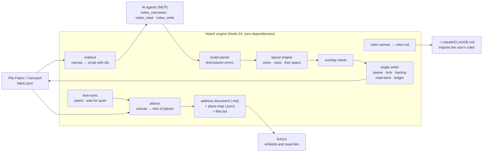

# NoteX

**The bridge between a spatial canvas and AI: it turns File Fabric / CanvasX canvases into documents AI can search, and lets AI agents write on those canvases safely.**


People plan on infinite canvases: boxes inside boxes, notes with checklists, files dropped next to the idea they belong to, and lines linking related things. That layout *is* information: what sits inside what, what is next to what, what is linked. A plain text export throws it away.

NoteX keeps it, in both directions:

1. **Canvas → AI.** NoteX reads a canvas and writes it out as a tree of **places**. Every place has an address such as `Thesis (totem) > Reading plan > Collect`, which travels with everything inside it. RAGX embeds those documents, so an AI answer can say *where* on the canvas something is.
2. **AI → canvas.** Agents write on a canvas in a small **tag-based script language**. They describe only *what goes inside what*. NoteX works out every size and position, checks for overlaps, and writes the canvas without ever touching the user's own items.

It runs as a page inside ter-manager (a desktop app that hosts plugins), as a command-line tool, and as an **MCP server** for AI coding agents.

---

## Why this was hard

| Problem | What NoteX does |
|---|---|
| **The canvas file is the app's internal state**, not a document format. Nesting, pages and grouping depend on rules inside the app's 11,000-line `script.js`. | File Fabric's geometry and placement rules were **ported line by line**, odd corners included, with the original line number beside each function. NoteX trusts what the app saved and uses the ported rules only where a value is missing. |
| **Two writers, one file.** File Fabric keeps an open canvas in memory and overwrites `fabric.json` on every save. | NoteX is the **only** writer for agents. Scripts wait in a persisted queue until the canvas's `.fabric_lock` is stale (30 s, the same rule File Fabric uses). Each write re-reads the file, checks that neither the file nor the lock changed, keeps a backup (last 20 per canvas), writes a temp file and renames it into place, **reads it back**, and restores the backup if anything promised is missing. |
| **Agents can't lay things out.** An LLM guessing pixel coordinates produces overlapping boxes. | A **layout engine** sizes everything from the inside out: text by wrapped lines at its font size, notes by File Fabric's own font and padding, images by the real size in the file header. It places boxes with `<Row>`/`<Column>`, finds free space so a new group can't be absorbed into a neighbouring one, grows parent boxes when content is added, and runs an **overlap check** before writing. |
| **No browser to measure text in** | Text sizes are estimated slightly large from File Fabric's own fonts and line heights. Once the app has drawn a text and saved its real height, the real height wins and boxes grow to fit. |
| **Agents must never damage the user's work** | Every item an agent writes is marked as the agent's, and a ledger fingerprints it. If the user later edits it, it becomes the user's: NoteX refuses to change, move or remove it. The user's own items are never moved; layout problems are reported, not "fixed". |
| **Clear errors for agents** | A hand-written parser with size and depth limits. Every refusal names its **line and column**, and a script is applied completely or not at all. |
| **Keeping the AI's copy current without hammering the machine** | Auto-sync checks watched canvases every 5 s, waits for 15 s of quiet after a save, syncs at most once a minute, and RAGX re-embeds only the places that changed. |
| **Images on a canvas** | Each image is read once by Claude Haiku (through RAGX), cached by its SHA-256, and its reading is written under the place where the image sits. |

---

## Architecture



---

## The totem script

This is how an agent writes on a canvas. The script says only what is inside what. Not one coordinate.

```xml
<Canvas name="Thesis">
  <Totem name="Reading plan">
    <Row>
      <Area name="Collect"><Note name="Todo">- [ ] find papers</Note></Area>
      <Area name="Read"><Text>Survey first.</Text></Area>
    </Row>
    <Link from="Collect" to="Read"/>
  </Totem>
</Canvas>
```

Later scripts can change the agent's own work:

```xml
<Add canvas="Thesis" at="Reading plan (totem) > Collect"> ... </Add>
<Canvas name="Thesis"><Edit id="1793...">new words</Edit></Canvas>
<Canvas name="Thesis"><Remove id="1794..."/></Canvas>
```

| Tag | Meaning |
|---|---|
| `<Canvas>` | the canvas to write on; created if it doesn't exist |
| `<Totem>` | a named group, the agent's own; one per script |
| `<Area>` | a box that holds other items |
| `<Note>` | a note card, with `- [ ]` checklists |
| `<Text>` | free text |
| `<File>` | a file or image, copied into the canvas |
| `<Row>` / `<Column>` | side by side / stacked inside a row |
| `<Link>` | joins two boxes corner to corner, as the app's own links do |
| `<Line>` | draws a line only |
| `<Add>` / `<Edit>` / `<Remove>` | grow, reword or delete the agent's own items |

`notex_read` returns a canvas as the same script, with every item's id and every totem's owner. An agent reads it first, then writes.

---

## Features

**Canvas → documents**
- Every canvas becomes an **address document** (Markdown, one section per place, its heading the place's full address) and a **place map** (JSON) for moving between places.
- Each place lists what it contains, its three nearest neighbours and which direction they lie in, its links, and checklist progress. Progress is read from the notes themselves, the same way File Fabric's progress bars count it.
- Files on a canvas are listed with their places, so RAGX can index a PDF *and* know which box it sits in.

**Keep in RAGX**
- Switch a canvas on and it follows File Fabric's saves into RAGX automatically.

**Rules canvas**
- Mark one canvas as your rules. NoteX writes your own typed words from it to `rules.md`, and one import line in `~/.claude/CLAUDE.md` gives every Claude Code session those rules. Only the user's words go in; agents are refused on this canvas.

**Agents write canvases (MCP)**

| Tool | Purpose |
|---|---|
| `notex_canvases` | list canvases, with scripts waiting or done |
| `notex_read` | a canvas, or one place on it, as a totem script with ids and owners |
| `notex_write` | send a totem script; it is written now, or queued while the canvas is open |

---

## Tech stack

- **Node.js 24**, ES modules, **zero npm dependencies**
- Hand-written parser, layout engine, overlap checker, PNG/JPEG/GIF/WebP/BMP header readers
- **MCP** server written by hand: JSON-RPC 2.0 over stdio
- Loopback HTTP server with token, origin and host checks
- Plugin page in vanilla HTML/CSS/JS

## By the numbers

| | |
|---|---|
| Engine and page source | ~4,900 lines |
| Tests | 76, all passing, in ~1,700 lines |
| Runtime dependencies | 0 |
| Commits | 22, each explaining *why* |

---

## Getting started

### Requirements
- Node.js **24 or newer**
- A File Fabric / CanvasX workspace folder
- **RAGX** running beside it, for search and image reading (optional for building documents)

### Install and test
```bash
npm test
```

### Command line
```bash
npm run notex -- fabrics "<workspace folder>"              # canvases, newest first
npm run notex -- build "<workspace>/<canvas>"              # print one canvas's document
npm run notex -- build "<workspace>" --out ./docs          # a whole workspace
npm run notex -- serve --data-dir ./data                   # the page's engine on 127.0.0.1:7781
```

### As a ter-manager plugin
```bash
npm run notex -- plugin-setup     # once
```
Then register the `plugin/` folder in ter-manager. (ter-manager is not public yet; see *Runs inside ter-manager* below.)

### For Claude Code (MCP)
```bash
claude mcp add --scope user notex -- node "<path to this repo>/engine/mcp.js"
```

---

## Project layout

```
engine/
  cli.js            command-line tool
  mcp.js            MCP server for agents
  lib/
    fabric.js       reads the workspace (never changes it)
    geometry.js     File Fabric's geometry, ported line by line
    rules.js        File Fabric's placement rules, for missing values
    places.js       canvas → tree of places with addresses
    wires.js        links, checklists, progress
    document.js     address document + place map
    files.js        files on a canvas, with their places
    images.js, read.js   image readings through RAGX
    sync.js         Keep in RAGX auto-sync
    agentrules.js   rules canvas → rules.md
    script.js       totem script parser
    measure.js      sizes as File Fabric draws them
    layout.js       the layout engine
    check.js        overlap check
    writer.js       the single writer: queue, lock, backup, read-back, ledger
    readout.js      canvas → totem script
    server.js       loopback server for the page
plugin/             the ter-manager page
test/               node:test suites
```

## Runs inside ter-manager

ter-manager is my own terminal and workspace manager that hosts plugins like this one; it is not public yet. Without it, everything still works from the command line: start the engine with `serve` and use the CLI or the MCP server.

NoteX is a **ter-manager plugin**. Its page (`plugin/`) opens in ter-manager's sidebar as **NoteX — File Fabric as places**, and ter-manager gives it a data folder of its own. The page starts and stops the engine on `127.0.0.1:7781` itself. It talks to the engine through ter-manager's plugin protocol, and the engine accepts requests only from that page. The command line and the MCP server use the same engine, so the page, the terminal and AI agents all see the same data.

## GitX ready

This repository is set up for the **GitX workflow**, so any AI coding agent that opens it works the same disciplined way:

- `AGENTS.md` holds the instructions once; `CLAUDE.md` and `GEMINI.md` import it, so **Claude Code** and **Google Antigravity** both follow it.
- The `gitx-workflow` skill ships in `.claude/skills/` and `.agents/skills/`, and a hook in `.claude/settings.json` checks the workflow after every edit and at the end of each turn, when GitX is installed on the machine (without it, the hook stays silent).
- Agents catch up on recorded decisions before changing anything, record new decisions, rejected alternatives and costs as they happen, cite them in code comments by id, and commit with GitX trailers (`GitX-Builds-On`, `GitX-Thoughts`, …).
- Each commit message carries its GitX trailers, so the reasoning behind every change travels with the code; the full decision record stays private in `.gitx/`.

## How it was built

Design decisions, rejected alternatives and accepted costs are recorded with **GitX**, my own decision-record workflow, as the work happens. The ids in code comments (for example `t-12859aa2fb`: "agents give content, NoteX decides positions") point to them. Each commit message explains why the change was made. Run `git log` to follow the design.

## Related projects

- **RAGX**: the local RAG engine that embeds and searches NoteX's documents.
- **CanvasX**: the infinite canvas app NoteX reads and writes.

## License

Copyright (C) 2026 Paveen Pratheek.
NoteX is free software under the **GNU Affero General Public License v3 or later**. See [LICENSE](LICENSE) and [NOTICE](NOTICE). The name "NoteX" is not licensed for use by modified versions.
